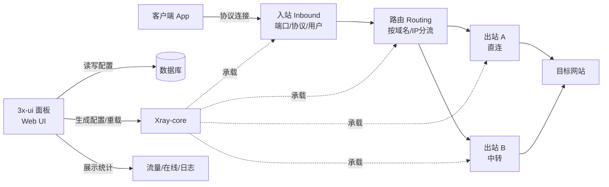

# 3x-ui / Xray 学习笔记（仅隔离环境学习）

> **声明**：本文只用于理解开源软件的架构与工作原理，不构成部署、配置或运营指导；不得用于对外提供代理服务。国内未经批准经营国际联网业务属于违法行为，学习请在隔离虚拟机/实验网络中进行。

## 1. 它是什么

- **Xray-core**：真正负责代理转发、加密、路由的网络核心，支持 VLESS、VMess、Trojan、Shadowsocks 等协议。
- **3x-ui**：Xray 的 **Web 管理面板**（x-ui 的社区维护分支）。它不参与流量转发，只做三件事：
  1. 把 Xray 的配置可视化；
  2. 修改配置后让核心重载；
  3. 展示流量、在线数、日志等统计。
- **数据库**：保存面板账号、入站、客户端、流量统计等。
- **systemd**：托管面板与核心进程，负责开机自启、崩溃重启。

一句话：**3x-ui 是控制面，Xray 是数据面。**

## 2. 架构图



ASCII 版：

```
客户端 ──► 入站(Inbound) ──► 路由(Routing) ──► 出站(Outbound) ──► 目标
                                   │
                                   ├─ 直连
                                   └─ 中转

面板(Web UI) ──► 数据库
     │
     └──► 生成配置 / 重载 ──► Xray-core（真正转发流量）
```

## 3. 组件职责

| 组件 | 职责 | 不负责 |
|---|---|---|
| 3x-ui 面板 | 配置管理、用户管理、流量统计、订阅生成、日志查看 | 不转发流量 |
| Xray-core | 协议握手、加密、路由、转发 | 不提供 Web 界面 |
| 数据库 | 存面板配置、用户、流量计数 | 不参与转发 |
| systemd | 进程守护、开机自启、日志收集 | 不管理业务配置 |
| 客户端 App | 导入订阅、建立连接 | 不感知服务端面板 |

## 4. 一次连接的数据流

1. 客户端用订阅里的地址、端口、UUID、协议参数发起连接。
2. 请求到达服务端 **入站**，入站校验协议与用户身份。
3. 命中 **路由规则**：按域名/IP/端口决定走哪个出站。
4. 从 **出站** 发出，到达目标网站。
5. 面板只记录流量计数、在线状态，不介入每一步转发。

## 5. 功能模块

| 模块 | 作用 | 关键概念 |
|---|---|---|
| 仪表盘 | CPU/内存/在线数/上下行流量 | 实时状态、历史曲线 |
| 入站管理 | 定义监听端口、协议、传输方式 | port、protocol、streamSettings |
| 客户端/用户 | 每个用户的凭据、配额、到期时间 | UUID、flow、limit、expiry |
| 出站管理 | 定义流量从哪里出去 | freedom、blackhole、proxy |
| 路由 | 按规则分流 | domainStrategy、rules |
| DNS | 解析策略 | servers、hosts |
| 证书/TLS | 域名证书、回落 | SNI、ALPN、fallbacks |
| 订阅 | 生成客户端可导入的链接 | subscription、base64 |
| 日志/备份 | 排错、迁移 | access.log、error.log、导出 |

## 6. 终端层面在管什么（通用概念）

终端不是在“操作代理”，而是在管理一个普通 Linux 服务：

- **服务生命周期**：查看状态、启动/停止/重启、开机自启。
- **日志**：看服务输出、错误、访问记录，定位“为什么起不来”。
- **配置与备份**：改配置前先备份，改完校验再重启。
- **端口与防火墙**：确认监听端口、放行规则、是否被占用。
- **资源**：CPU、内存、磁盘、连接数，判断瓶颈。

这些能力与具体软件无关，换成 Nginx、PostgreSQL、Node 服务，方法是一样的。

## 7. 术语表

| 术语 | 含义 |
|---|---|
| Inbound | 入站，服务端监听并接收客户端连接 |
| Outbound | 出站，服务端把流量发往目标的方式 |
| Routing | 路由，按规则决定流量走哪个出站 |
| UUID | 用户唯一标识，常见于 VLESS/VMess |
| SNI | TLS 握手时的目标域名 |
| TLS / ALPN | 加密层与协议协商 |
| WS / gRPC | 常见的传输层封装方式 |
| 订阅 | 把多个节点打包成客户端可导入的链接 |
| 流量配额 | 单用户可用流量上限 |
| 回落（fallback） | 非代理请求转到本地 Web 服务 |

## 8. 学习路径（建议）

1. 读官方文档与 README，先搞清“面板 / 核心 / 配置”三者关系。
2. 打开一份 Xray 配置文件，对照面板里的字段，理解每个字段落到哪里。
3. 在隔离环境里改一个参数（如端口），观察配置文件变化与核心重载。
4. 看日志：正常连接、认证失败、路由命中分别长什么样。
5. 画一张自己的数据流图，能讲清楚“一个请求从进到出经过了什么”。

## 9. 合规边界

- 国内未经批准擅自经营国际联网业务、向公众提供代理服务，属于违法行为。
- 学习请在隔离虚拟机/实验网络，不接真实用户、不做对外宣传。
- 不要把这套东西包装成“跨境电商基础设施”对外销售。
- 本文不提供安装、部署、节点配置步骤；需要实验请查官方文档并在隔离环境进行。
